# 👨🏻‍💻 Henriwue

**`Desenvolvedor Full Stack | Software Engineering Student `**

Me chamo **Henrique Viana**, tenho 21 anos e sou do Paraná. Sou formado como **Técnico em Informática pelo IFPR** e atualmente curso **Bacharelado em Engenharia de Software na UniCesumar**.

Minha stack de estimação é o **Laravel**, mas não tenho compromisso e exclusividade. Também trabalho com **PHP, Python, TypeScript e React**, explorando diferentes tecnologias conforme o projeto necessita. Recentemente, venho dedicando parte do meu tempo livre a explorar **inteligência artificial e automação de processos**, integrando essas tecnologias aos meus projetos.

Este perfil reúne meus projetos, experimentos e parte da minha evolução como desenvolvedor. Nem toda ideia se transforma em um grande projeto, mas cada uma rende algo novo

---

### 🛠️ Tecnologias

---

### 🚀 Projetos em Destaque

#### 🧠 1. Auvren — Gestão Inteligente de Chamados com IA

**`Python` `FastAPI` `React` `TypeScript` `PostgreSQL` `Google Gemini` `Docker`**

Plataforma full stack de gerenciamento de chamados corporativos, com **triagem assistida por inteligência artificial**, autenticação JWT e controle de acesso baseado em papéis (RBAC).

O sistema permite que funcionários abram e acompanhem solicitações, enquanto agentes de suporte gerenciam os atendimentos e utilizam recursos de IA para auxiliar na triagem.

**Principais funcionalidades:**
- API REST com FastAPI, SQLAlchemy e PostgreSQL.
- Integração com Google Gemini para triagem de chamados.
- Dashboard com indicadores de atendimento.
- Autenticação JWT e três perfis de acesso: administrador, agente e funcionário.
- Isolamento de dados por organização e usuário.
- Histórico de alterações e gerenciamento de status.
- **118 testes automatizados de backend aprovados.**
- **19 testes funcionais do portal do funcionário aprovados.**

**Status:** `v0.1.0 — MVP funcional`

---

#### ♻️ 2. ComPartilhe — Economia Solidária e Moda Circular

**`PHP` `Laravel` `MySQL` `Blade` `Docker`**

Plataforma web desenvolvida para apoiar o projeto **ComPartilhe, do Instituto Federal do Paraná (IFPR — Câmpus Paranaguá)**, promovendo a economia solidária, a moda circular e o consumo consciente.

A aplicação digitaliza a gestão de feiras de troca e doações, oferecendo:

- Controle de estoque e acervo de peças doadas.
- Gerenciamento de créditos sociais utilizados nas trocas.
- Registro de transações e movimentações.
- Organização de dados para acompanhamento das atividades do projeto.

O sistema busca substituir processos manuais por uma solução centralizada de gestão, contribuindo para uma iniciativa de impacto social e ambiental.

---

#### 🏪 3. Kitcho SaaS — Gestão para Pequenos Estabelecimentos

**`PHP` `Laravel` `PostgreSQL`**

Sistema SaaS desenvolvido para auxiliar pequenos estabelecimentos na **gestão de cardápios e pedidos**, reunindo funcionalidades operacionais em uma aplicação web.

O projeto explora o desenvolvimento de software voltado a negócios, com foco em organização de informações, persistência de dados e estruturação de uma aplicação com potencial comercial.

---

### 🧩 Conhecimentos e Práticas

- **Backend:** APIs REST, arquitetura de aplicações, autenticação JWT, autorização RBAC e regras de negócio.
- **Frontend:** interfaces com React, TypeScript, integração com APIs e gerenciamento de estado.
- **Banco de dados:** modelagem relacional, SQL, PostgreSQL e MySQL.
- **Qualidade:** testes automatizados com Pytest, validação de dados e versionamento com Git.
- **Infraestrutura:** Linux, Docker, Docker Compose e configuração de ambientes.
- **Inteligência artificial:** integração de modelos de IA a aplicações e automação de fluxos.

---

### 📚 Atualmente Estudando e Aprofundando

- Engenharia e arquitetura de software.
- Desenvolvimento full stack com Python, PHP e TypeScript.
- Testes automatizados e qualidade de software.
- Inteligência artificial aplicada a sistemas.
- Segurança de aplicações e boas práticas de desenvolvimento.
- Containerização, infraestrutura e deploy.

---

### 📊 GitHub

  

  

---

### 📫 Contato

  
  

